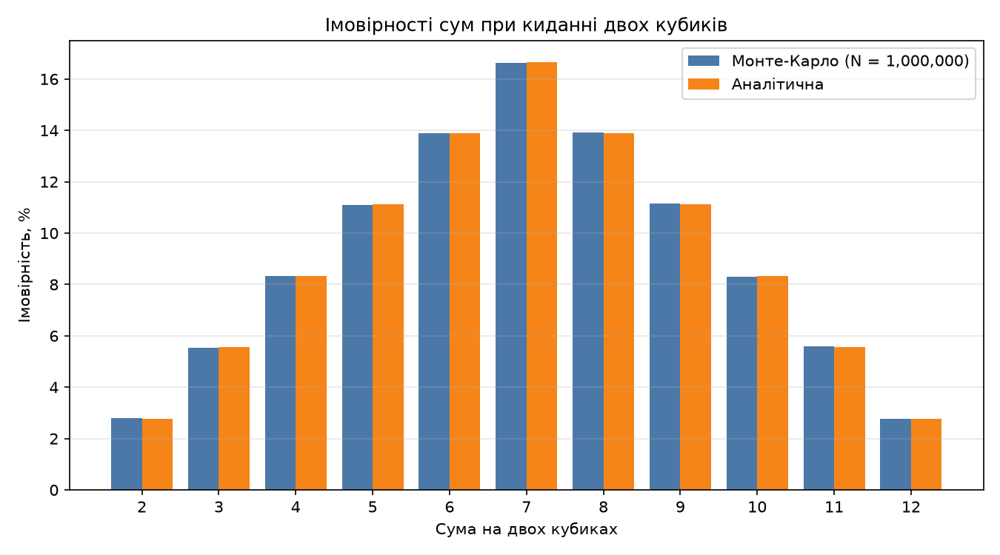

# Завдання 7. Метод Монте-Карло: кидання двох кубиків

## Опис

Програма `monte_carlo_dice.py` імітує `N = 1 000 000` кидків двох шестигранних кубиків, підраховує, скільки разів випала кожна сума (2–12), і оцінює ймовірність як `частота / N`. Результат порівнюється з аналітичними ймовірностями `P(s) = (6 − |s − 7|) / 36`.

Запуск (потрібен `matplotlib`):

```bash
python3 monte_carlo_dice.py
```

Скрипт друкує таблицю в консоль і зберігає графік `dice_probabilities.png`. Генератор ініціалізується `seed=42`, тому результати відтворюються.

## Результати (N = 1 000 000)

| Сума | Монте-Карло | Аналітична | Різниця, в.п. |
|-----:|------------:|-----------:|--------------:|
| 2  | 2.81%  | 2.78% (1/36)  | +0.029 |
| 3  | 5.53%  | 5.56% (2/36)  | −0.022 |
| 4  | 8.32%  | 8.33% (3/36)  | −0.017 |
| 5  | 11.10% | 11.11% (4/36) | −0.011 |
| 6  | 13.88% | 13.89% (5/36) | −0.005 |
| 7  | 16.63% | 16.67% (6/36) | −0.037 |
| 8  | 13.93% | 13.89% (5/36) | +0.043 |
| 9  | 11.15% | 11.11% (4/36) | +0.036 |
| 10 | 8.29%  | 8.33% (3/36)  | −0.042 |
| 11 | 5.59%  | 5.56% (2/36)  | +0.030 |
| 12 | 2.77%  | 2.78% (1/36)  | −0.005 |

Максимальне відхилення: **0.043 в.п.**



## Збіжність залежно від кількості кидків

| N | Максимальне відхилення, в.п. |
|--:|-----------------------------:|
| 100       | 7.333 |
| 1 000     | 1.489 |
| 10 000    | 0.373 |
| 100 000   | 0.211 |
| 1 000 000 | 0.043 |

## Висновки

1. **Аналітичні розрахунки підтверджено.** При 1 000 000 кидків усі одинадцять оцінок збігаються з теоретичними значеннями з точністю до 0.05 відсоткового пункту. Форма розподілу також збігається: трикутна, симетрична відносно суми 7, мінімум на 2 і 12, максимум на 7 (≈16.7%).

2. **Відхилення мають випадковий характер.** Стандартна похибка оцінки ймовірності дорівнює √(p(1−p)/N). Для суми 7 при N = 10⁶ це ≈ 0.037 в.п., а спостережене відхилення — 0.037 в.п., тобто близько одного σ. Знаки відхилень змішані (частина вище теорії, частина нижче), системного зсуву немає.

3. **Точність зростає з N.** Похибка спадає приблизно пропорційно 1/√N: збільшення N у 100 разів (з 10⁴ до 10⁶) зменшує максимальне відхилення приблизно в 9 разів (0.373 → 0.043), що узгоджується з очікуваними 10. Точки на проміжних N не лежать на ідеальній кривій, бо це один прогін з одним seed; для малих N (100–1000) оцінки ще грубі — відхилення сягають 7 і 1.5 в.п.

4. **Практичний висновок.** Метод Монте-Карло дає правильний результат без виведення формули, але потребує великої кількості випробувань: кожна додаткова цифра точності коштує у 100 разів більше обчислень. Для такої простої задачі, де аналітичне рішення відоме (36 рівноймовірних пар), точний підрахунок кращий; перевага Монте-Карло проявляється там, де аналітичний розв'язок складний або недоступний.